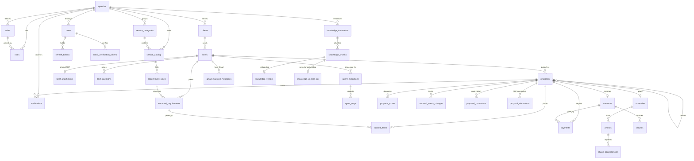

# base-de-datos-CotizaIA

PostgreSQL 16 database for [CotizaIA](https://github.com/GUERRREROALEXANDER/backend-cotizaIA).

## Contents

| Path | What it is |
|---|---|
| `migrations/V1..V30__*.sql` | Flyway migrations, the source of truth (copied from the backend's `src/main/resources/db/migration`; `V24__pgvector.sql` is the PostgreSQL vendor migration from `db/vendor/postgresql`) |
| `schema.sql` | Full schema (`pg_dump --schema-only --no-owner --no-privileges`) after Flyway applied all 30 migrations |

## Restore

```bash
createdb -U cotizaia cotizaia
psql -U cotizaia -d cotizaia -v ON_ERROR_STOP=1 -f schema.sql
```

The last block of `schema.sql` creates `knowledge_vectors_pg` and needs the **pgvector** extension (the
`pgvector/pgvector:pg16` image in the backend's `docker-compose.yml` has it). Without pgvector, everything before
that block still restores.

Or let the backend create it: `docker compose up -d` then `./mvnw spring-boot:run` and Flyway applies the migrations
on startup.

Verified on 2026-11-20: migrations V1–V30 are byte-identical to the backend's; Flyway 11 applied all 30 on an
empty `pgvector/pgvector:pg16` database (PostgreSQL 16.16) with no error, and `schema.sql` restores cleanly with
`ON_ERROR_STOP=1` into an empty database: 36 tables including `flyway_schema_history` and `knowledge_vectors_pg`.
On PostgreSQL without pgvector, everything before the last block restores (35 tables). The dump has no PostgreSQL
17+ settings (`transaction_timeout` removed), so it loads on 16. The pgvector block now names its schema
(`CREATE EXTENSION ... WITH SCHEMA public`): the dump clears `search_path`, so the previous bare `CREATE EXTENSION`
stopped the restore with "no schema has been selected to create in".

## Demo data

There are no `INSERT` scripts on purpose: client and agency content (names, emails, brief text, proposal texts,
PDFs) is encrypted at rest with AES-256-GCM by the application, so rows written by plain SQL would be unreadable to
the backend. The demo agency (*Estudio Nariño Digital*: catalog, rates, 30 clients, 24 past proposals as memory and
10 proposals in every lifecycle state) is loaded through the API with `python scripts/seed_demo.py` in the backend
repository. Login: `demo@estudio-narino.test` / `CotizaIA-demo-2026`.

## Entity-relationship diagram



## Tables

| Area | Tables |
|---|---|
| Identity | `agencies`, `users`, `refresh_tokens`, `email_verification_tokens`, `clients` |
| Configuration | `roles`, `rates`, `service_categories`, `service_catalog`, `requirement_types` |
| Intake | `briefs`, `brief_attachments`, `brief_questions`, `extracted_requirements`, `gmail_ingested_messages`, `gmail_sync_state` |
| Agent | `agent_executions`, `agent_steps` |
| Quotation | `proposals`, `quoted_items`, `proposal_extras`, `proposal_status_changes`, `proposal_commands`, `proposal_documents` |
| Planning and closing | `schedules`, `phases`, `phase_dependencies`, `contracts`, `clauses`, `payments`, `notifications` |
| Estimation memory (RAG) | `knowledge_documents`, `knowledge_chunks`, `knowledge_vectors`, `knowledge_vectors_pg` |
| Flyway | `flyway_schema_history` |
